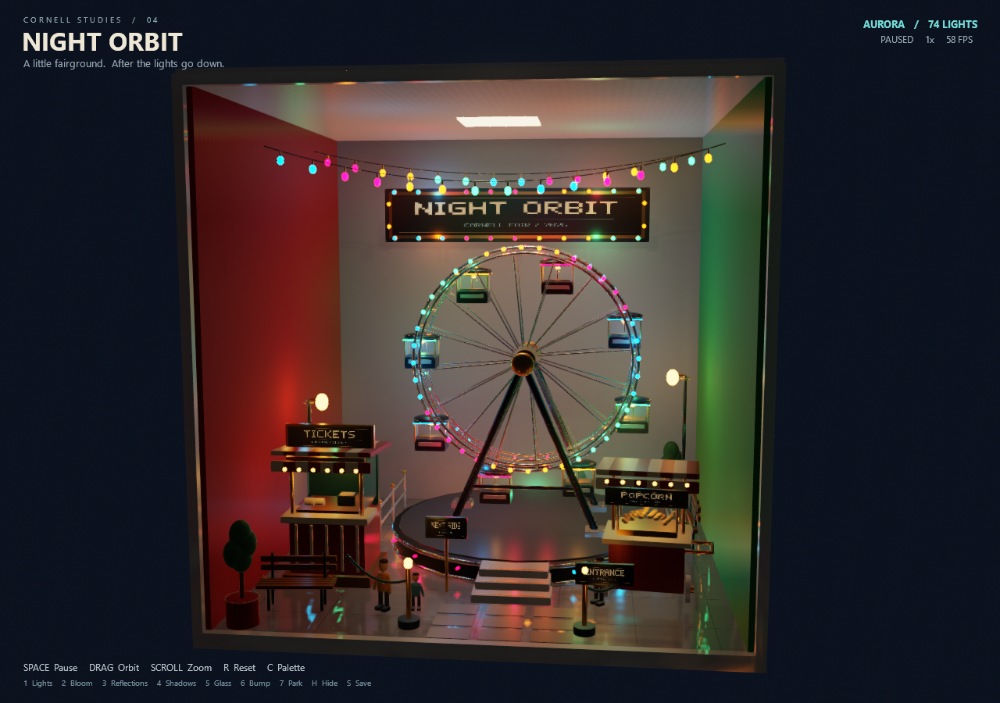

# NIGHT ORBIT — HW4 Extra

Cornell Box 안에서 천천히 회전하는 야간 미니어처 놀이공원이다. 관람차를 뒤쪽에 놓고 앞에는 매표소·팝콘 카트·입장 통로, 주변에는 벤치·울타리·가로등·화분·방문객을 배치했다. 천장의 두 줄 전구와 뒷벽의 발광 간판이 상단 공간을 채운다. 빨간 왼쪽 벽, 초록 오른쪽 벽, 흰색 뒷벽·천장·바닥과 천장 면 광원을 유지한다.



## 실행

Python 3.12, pyglet 2.1.16, OpenGL 3.3 이상이 필요하다. 모델과 텍스처를 별도로 다운로드할 필요는 없다. 기존 `HW4`에서 파일을 불러오지 않으므로 이 폴더만으로 실행할 수 있다.

프로젝트 루트에서 기존 과제 환경으로 실행:

```powershell
conda activate snu_graphics_hjj
python ".\HW4 Extra\main.py"
```

현재 컴퓨터에서 환경 활성화 없이 실행:

```powershell
& 'D:\anaconda3\envs\snu_graphics_hjj\python.exe' '.\HW4 Extra\main.py'
```

별도 환경을 만들 경우:

```powershell
conda env create -f ".\HW4 Extra\environment.yml"
conda activate snu_graphics_hjj_hw4_extra
python ".\HW4 Extra\main.py"
```

일반 Python 환경에서는 `python -m pip install -r ".\HW4 Extra\requirements.txt"`로 의존성을 설치할 수 있다.

## 조작

| 입력 | 기능 |
|---|---|
| 왼쪽 드래그 | 카메라 회전 |
| 오른쪽/가운데 드래그 또는 Shift + 왼쪽 드래그 | 카메라 이동 |
| 마우스 휠 | 확대·축소 |
| Space | 관람차 정지·재생 |
| R | 카메라 초기화 |
| F / V | 정면 / 사선 시점 |
| C | Aurora → Golden Hour → Electric Blue 팔레트 |
| 1 | 관람차와 주변 시설의 국소 조명·발광 켜기·끄기 |
| 2 | Bloom 켜기·끄기 |
| 3 | 바닥 반사와 환경 반사 켜기·끄기 |
| 4 | 그림자 켜기·끄기 |
| 5 | 곤돌라·매표소·팝콘 진열창의 유리 켜기·끄기 |
| 6 | 바닥 bump와 표면 미세 요철 표현 켜기·끄기 |
| 7 | 주변 놀이공원 시설 켜기·끄기 |
| + / - | 노출 조절 |
| [ / ] | 회전 속도 절반 / 두 배 |
| H | HUD 숨기기·보이기 |
| S | `captures/`에 현재 화면 PNG와 설정 JSON 저장 |
| Q / Esc | 종료 |

한 바퀴 회전 시간은 기본 속도에서 75초다. 곤돌라는 회전하는 바퀴에 연결된 지점의 위치만 따라가며 수평을 유지한다. 조명과 그림자도 회전에 맞춰 갱신된다. `1`을 끄면 비교가 가능하도록 천장 조명은 남겨 둔다.

## 구현한 내용

### 형상과 배치

- 모든 모델을 코드로 생성했다. 기본 형상은 box, UV sphere, cylinder, torus, quad 다섯 가지다.
- 이중 금속 림, 32개의 살대, 8개의 수평 곤돌라, 앞뒤 A자 지지대, 축과 허브, 원형 받침대를 배치했다.
- 관람차 전체에 0.85배의 균일 축소와 뒤쪽 이동을 적용해 앞쪽 공간을 확보했다. 관람차의 조명도 같은 행렬로 옮기고, 광원 power에는 축척의 제곱을 곱해 상대적인 조도를 유지한다.
- 주변 시설은 `fairground.py`에서 생성한다. 줄무늬 차양과 창이 있는 매표소, 유리 진열창·팝콘 알갱이·바퀴가 있는 카트, 계단, 입구 기둥과 처진 로프, 두 벤치, 울타리, 가로등, 화분과 방문객 3명을 포함한다.
- 두 줄 전구의 케이블은 포물선으로 처짐을 근사하고 짧은 cylinder로 이어 만든다. 뒷벽에는 전구로 둘러싼 큰 간판을 배치했다.
- 둘레에 전구 40개씩, 총 80개가 있다. 곤돌라에는 색이 있는 지붕 테두리와 따뜻한 내부등이 있다.
- 같은 형상의 모델은 `glDrawElementsInstanced`로 묶어 렌더링한다. 모델 행렬, base color, metallic, roughness, alpha, emission을 instance buffer에 저장한다.

### 조명

주변 시설을 포함하면 총 **74개의 실제 조명 샘플**을 fragment shader에서 합산한다. 셰이더 예산은 80개다.

| 구분 | 수 | 역할 |
|---|---:|---|
| 천장 면 광원의 2×2 샘플 | 4 | 기본 조명과 그림자 |
| 관람차 둘레 | 40 | 인접 전구 두 개당 하나의 대표 point light |
| 곤돌라 내부 | 8 | 따뜻한 내부 조명 |
| 받침대 | 8 | 바닥에 가까운 색 조명 |
| 가로등 | 2 | 휴게 공간 조명 |
| 뒷벽 간판 | 4 | 간판과 벽의 색 조명 |
| 천장 전구 줄 | 4 | 두 케이블에 광원 2개씩 |
| 매표소 | 1 | 창과 카운터의 따뜻한 조명 |
| 팝콘 카트 | 1 | 투명 진열창의 조명 |
| 입장 기둥 | 2 | 전경과 입장 통로 조명 |

빛을 내는 모델의 emission과 실제 주변을 밝히는 광원을 별도로 계산한다. 광원 색은 sRGB에 가까운 조절값에서 `color^2.2`로 선형화하고, 직접광은 `power / (distance² + radius²)`로 감쇠한다. `radius`는 점 광원 바로 근처의 과도한 밝기를 줄이는 정규화 값이다. 실제 구형 면 광원을 적분한 것은 아니다. 천장 샘플에는 아래 방향의 cosine도 적용한다.

### 재질과 매핑

- 직접광에는 **Lambert diffuse + Cook–Torrance specular**를 사용한다. 정반사 항은 GGX NDF, height-correlated Smith-GGX visibility, Schlick Fresnel의 조합이다.
- 금속은 난반사를 줄이고 base color를 F0로 사용한다. dielectric F0는 0.04다. roughness는 최소 0.09로 제한하고, `alpha = roughness²`로 변환한다.
- 금속의 미세한 roughness 패턴은 화면 미분으로 약화하고, 법선 미분에 따라 roughness를 넓혀 얇은 살대의 specular aliasing을 줄인다.
- 바닥에는 world XZ 좌표를 이용한 타일·미세 입자 패턴과 사인 높이장의 도함수로 만든 **procedural bump mapping**을 적용한다. 벽에는 약한 plaster 패턴, 금속에는 미세 roughness 패턴이 있다.
- 명판은 자체 5×7 bitmap 글꼴로 만든 RGB 텍스처를 quad의 UV로 샘플링한다. 8개 간판을 하나의 2×4 atlas에 저장하고, surface ID에 따라 UV 영역을 선택한다. 벤치에는 UV를 이용한 나뭇결 패턴을 적용했다. 외부 이미지나 AI 생성 이미지를 사용하지 않았다.

### 반사

1. **바닥의 planar reflection:** 바닥 평면에 대해 eye·target·up을 반사시킨 카메라로 바닥을 제외한 장면을 절반 해상도 HDR 텍스처에 매 프레임 렌더링한다. 평면 아래 fragment를 버리고, 본 패스에서 투영 좌표로 조회해 Fresnel에 따라 합성한다. 바닥 요철과 작은 5-tap 필터로 반사를 약하게 흐린다.
2. **금속·유리의 environment reflection:** 방과 발광 물체를 128×128×6 HDR cubemap에 렌더링한다. 방의 경계에 대한 box projection으로 벽의 parallax를 보정하고, roughness에 따라 mip level을 선택한다. cubemap은 시뮬레이션 시간 기준 0.4초마다 갱신한다.

probe에는 방·주변 시설·발광 물체를 담고 관람차의 불투명 구조와 유리는 제외해 중심 축이 probe 전체를 가리지 않게 했다. 따라서 관람차 구조물끼리의 환경 반사와 정확한 발광체 parallax는 재현하지 않는다. 일반 mipmap을 이용한 흐림이며, GGX로 미리 적분한 IBL이나 완전한 간접광 계산은 아니다. 바닥 반사는 매 프레임 갱신되지만 금속의 환경 반사에는 짧은 갱신 지연이 있다.

### 투명 합성

곤돌라 하나당 4개인 32개와 매표소 2개·팝콘 카트 4개를 합쳐 총 38개의 유리 pane을 별도 quad로 그린다. 먼저 불투명 물체를 그린 후, 현재 카메라의 view-space Z로 pane을 뒤에서 앞으로 정렬한다. depth test는 켜고 depth write는 끈 상태에서 `SRC_ALPHA, ONE_MINUS_SRC_ALPHA`로 합성한다. 바닥의 반사 패스에서도 반사된 카메라를 기준으로 다시 정렬한다. 유리는 얇은 tinted glazing의 alpha·Fresnel 근사이며, 굴절·두께 기반 흡수·다중 계면 투과는 구현하지 않았다.

### 그림자

천장 면 광원의 4개 샘플에서 각각 1024×1024 depth map을 만든다. texture array에 저장하고, slope-dependent bias와 polygon offset, 3×3 PCF로 비교한다. 4개 광원의 가시성이 직접광 합산에 반영되어 면 광원의 그림자를 근사한다. 애니메이션 동안 매 프레임 갱신하고, 정지한 장면에서는 캐시한다.

나머지 70개 국소 광원에는 shadow map을 만들지 않으므로 이 광원들의 차폐와 색 그림자는 계산하지 않는다. 투명 유리도 shadow caster에서 제외했다. 면 광원의 샘플이 4개이므로 그림자가 완전히 연속적인 soft shadow는 아니다.

### HDR와 안티앨리어싱

메인 장면은 RGBA16F와 4× MSAA로 렌더링한 뒤 단일 HDR 텍스처로 resolve한다. 밝은 부분을 1/4 해상도로 추출하고 separable Gaussian blur를 반복해 bloom을 더한다. FXAA 방식의 간단한 가장자리 필터, 노출, ACES 계열 fitted tone curve, sRGB 변환과 미세 dithering을 거쳐 화면에 출력한다. Bloom은 화면 후처리이며 실제 광원 조명 계산은 별도로 존재한다.

## 검증과 비교 이미지

창을 만들지 않는 형상·애니메이션 검증:

```powershell
python ".\HW4 Extra\verify_scene.py"
```

고정 시각의 GPU 렌더링을 저장하고 종료:

```powershell
python ".\HW4 Extra\main.py" --hidden --capture ".\HW4 Extra\preview.png" --frames 5
python ".\HW4 Extra\main.py" --hidden --capture ".\HW4 Extra\captures\angle.png" --view angle --time 18
python ".\HW4 Extra\main.py" --hidden --capture ".\HW4 Extra\captures\ceiling_only.png" --disable lights
python ".\HW4 Extra\main.py" --hidden --capture ".\HW4 Extra\captures\no_reflections.png" --disable reflections
python ".\HW4 Extra\main.py" --hidden --capture ".\HW4 Extra\captures\wheel_only.png" --disable fairground
```

`--no-hud`로 안내 없이 캡처할 수 있다. `--palette 0/1/2`, `--width`, `--height`, `--time`, `--shadow-size 512/1024/2048`도 지원한다. PNG 옆의 JSON에는 광원·삼각형 수, 효과 설정, 카메라, OpenGL 장치, 오류 코드 등을 기록한다. JSON의 `cpu_submission_ms`는 CPU에서 렌더 명령을 제출한 평균 시간이며 GPU 성능 측정치는 아니다.

현재 작업 환경의 NVIDIA GeForce RTX 4060 / OpenGL 4.6에서 기본 장면, 6개 효과 및 주변 시설을 각각 끈 장면, 두 추가 팔레트, 사선 시점과 다른 회전 시각을 포함해 **12개 GPU 렌더링을 검증**했다. 모두 정상 종료했고 OpenGL 오류 코드는 0이었다. 동일 시점의 효과 ON/OFF 이미지에서 실제 픽셀 차이도 확인했다. 수치 결과는 `verification.json`, 비교 이미지는 `captures/check_*.png`에 있다. `captures/`는 Git 추적에서 제외한다. 창을 만들지 않는 검증에서는 회전 중의 수평 유지, 모든 도형이 Cornell Box 안에 들어가는지, 주변 시설 ON/OFF/ON 시 이전 instance가 남지 않는지도 확인한다.

## 파일 구성

| 파일 | 내용 |
|---|---|
| `main.py` | 실행, 카메라, 입력, HUD, 캡처 |
| `scene.py` | 관람차 모델, 재질, 조명, 애니메이션, 팔레트 |
| `fairground.py` | 주변 시설·방문객·전구 줄·간판과 조명 |
| `geometry.py` | 기본 형상과 OpenGL instancing |
| `shaders.py` | GLSL 재질·그림자·후처리 |
| `renderer.py` | HDR·그림자·반사·투명 합성 패스 |
| `textures.py` | 8개 간판의 텍스처 atlas 생성 |
| `verify_scene.py` | 형상 방향, 곤돌라 수평, 장면 경계, 조명 예산과 표시 전환 검증 |
| `References.md` | 알고리즘 출처와 AI 사용 범위 |

보고서에는 실제 구현과 위에 적은 근사를 구분해서 설명해야 한다. 특히 74개 조명 전체가 그림자를 만드는 것, 물리적인 유리 굴절, 완전한 global illumination으로 설명하면 구현과 다르다.
